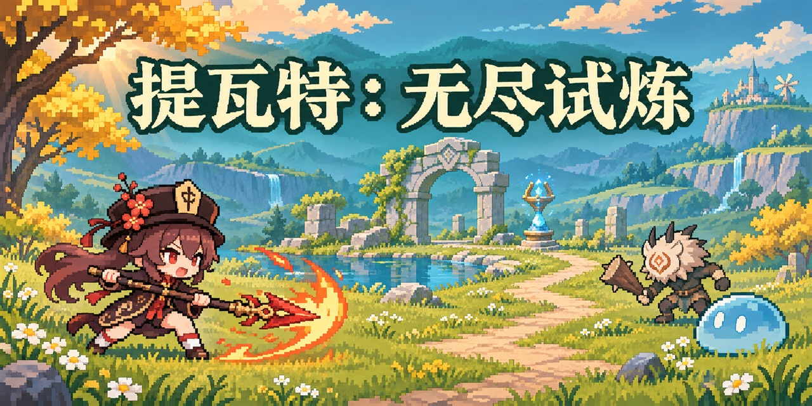

# 提瓦特：无尽试炼




以《原神》角色和世界观为主题的 2D 像素生存游戏。选择角色和装备进入试炼，在敌潮中走位、自动攻击并选择局内强化。结算后可用获得的资源培养角色和武器，或用于祈愿。

## 游玩

通过[宣传页](https://yzk258.github.io/TeyvaaatEndlessTrial/)的「开始游戏」进入浏览器单机版，点击大门后新建存档、继续游戏或导入备份。标题画面选择「下载离线资源」，显示就绪后即可用同一个浏览器从游戏地址断网启动。 [宣传页与游戏发布](site/README.md)

进度按浏览器与站点地址保存在本地。主界面可导出 JSON 备份，换设备或换网址时可导入为独立存档。返回标题可以切换存档。

## 玩法

- **无尽冒险**。选择 20、40、60、80 或 100 级难度，迎战逐波增强的敌潮。每十波出现丘丘岩盔王，击败后掉落圣遗物。主动撤离也会按进度结算。 [冒险规则](docs/ADVENTURE.md) · [地图生成](docs/TILE_MAPS.md)
- **关卡挑战**。从相同的五档难度选择一档，在固定场地使用出战时的属性作战，击败全部敌人后领取摩拉或原石。 [关卡与奖励配置](docs/ADVENTURE.md)
- **战斗与无尽成长**。用 WASD 或方向键移动，角色会自动攻击，按 Esc 暂停。无尽模式中可吸收经验，升级时从三个随机选项中选择强化。 [攻击判定](docs/ATTACKS.md) · [掉落与强化](docs/PROGRESSION.md)
- **培养、祈愿与图鉴**。「培养」菜单下可强化角色、更换装备或提升武器词条。角色池和武器池各有保底。图鉴可查看角色与武器的收集进度，以及怪物的基础数值。 [角色配置](docs/CHARACTERS.md) · [武器培养](docs/WEAPONS.md) · [祈愿规则](docs/WISHES.md)
- **圣遗物与背包**。背包可查看初学者套装。圣遗物培养消耗摩拉强化主词条，角色可装备五个部位并激活两件套与四件套效果。 [圣遗物规则](docs/ARTIFACTS.md)
- **本地存档与教程**。角色、装备、货币、祈愿保底和已结算的试炼会自动保存。进入综合页后，可点击「教程」逐步查看高亮指引。

## 本地开发

安装 Node.js 后，在项目根目录运行以下命令。

```powershell
npm --prefix frontend install
npm run dev
```

打开 [游戏页面](http://127.0.0.1:5175)。验证离线下载时，先运行 `npm run build`，再用 `npm --prefix frontend run preview` 启动生产构建的预览。

## 项目结构

游戏采用 React、TypeScript 和 SVG，战斗模拟通过纯函数更新状态。培养、祈愿与奖励结算在本地计算，相关进度通过 IndexedDB 事务保存。

| 目录                                                | 内容                                     |
| --------------------------------------------------- | ---------------------------------------- |
| [frontend/src/](frontend/src/)                       | 页面、战斗模拟与渲染                     |
| [frontend/public/](frontend/public/)                 | 游戏实际加载的像素素材                   |
| [frontend/src/game/local/](frontend/src/game/local/) | 本地存档、培养、祈愿和结算规则           |
| [shared/](shared/)                                   | 角色、武器和冒险等共享配置               |
| [tools/](tools/)                                     | 启动、运维和验证脚本                     |
| [docs/](docs/)                                       | 机制说明、素材记录和工作日志             |
| [site/](site/)                                       | 宣传页与单机游戏的 GitHub Pages 发布入口 |

## 验证

```powershell
npm run build
node tools/verify-battle.mjs
node tools/verify-local-save.mjs
```

## 开发记录

[工作日志](docs/WORKLOG.md) 收录历次开发记录和早期设计草案。 [素材说明](docs/ASSETS.md) 记录素材来源与用途。
